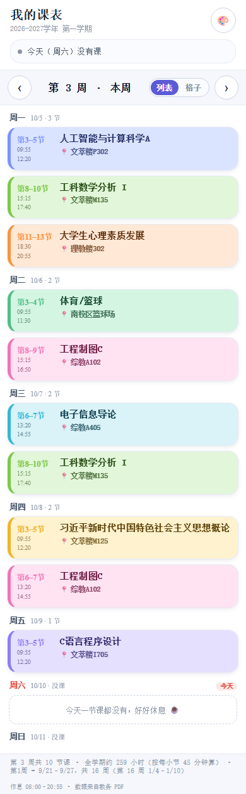
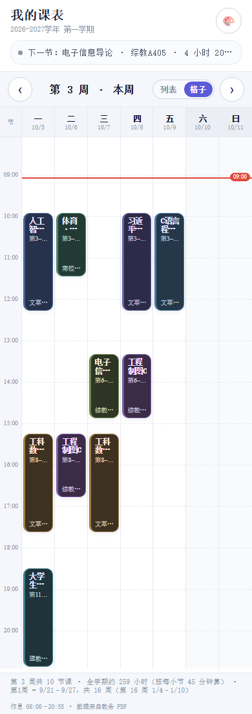

# 我的课表（北理工 2026-2027 第一学期）

把教务系统导出的课表（PDF）和学校的作息时间表合并成一个**手机上打开就能看、会跟着现实时间自动高亮**的课表网页。

纯静态单页，没有任何后端和外部依赖 —— 可以直接传到 GitHub Pages，然后用 iPhone 的 Safari「添加到主屏幕」，用起来和一个 App 没区别。

---

## 先看效果

| 列表视图（默认） | 格子视图 |
| --- | --- |
|  |  |

都是 iPhone 真实宽度 390px 用无头 Edge 实拍的，不是设计稿。更多截图在 `预览/`，一页对比在 `预览/看方案.html`。

---

## 课表本身

北京理工大学 ｜ 2026-2027 学年第一学期 ｜ 第 1 周 = **2026-09-21**，共 16 周（第 16 周 1/4–1/10）

> 页面会传到公开的 GitHub Pages，所以**页面上和源码里都不写姓名学号**（`src/data.js` 的 `META` 里只有学校、学期、开学日期）。备份文件里的"学期指纹"也只按 `termLabel` / `firstMonday` / `totalWeeks` 判断，不带个人信息。

作息（学校「上课时间表」，2021 年 8 月 23 日起实行）：

| 大节 | 小节 | 时间 |
| --- | --- | --- |
| 上午 第一大节 | 第 1–2 小节 | 08:00–09:35 |
| 上午 第二大节 | 第 3–5 小节 | 09:55–12:20 |
| 下午 第三大节 | 第 6–7 小节 | 13:20–14:55 |
| 下午 第四大节 | 第 8–10 小节 | 15:15–17:40 |
| 晚上 第五大节 | 第 11–13 小节 | 18:30–20:55 |

10 门课（`src/data.js` 里的 `COURSES`）：人工智能与计算科学A、体育/篮球、新时代实践教育I、习近平新时代中国特色社会主义思想概论、C语言程序设计、电子信息导论、工程制图C、工科数学分析 I、国家安全概论、大学生心理素质发展。

> 另有 3 条**时间待定**的：英语分级考试、军事理论、军事技能。它们只记在 `data.js` 的 `PENDING` 里、**页面上不显示**（`SHOW_PENDING = false`），教务排定了再填进去。

---

## 跑起来

**电脑上直接看**：双击 `北理工课表.html` 就行（但 `file://` 下 iPhone Safari 不让存设置，只是能看到课表）。

**手机上打开**：双击 **`启动手机访问.bat`**，它会打印一个局域网地址（形如 `http://192.168.x.x:5177`），手机连同一个 WiFi，用 Safari 打开这个地址。

**发布**：把 `index.html` 和 `icon-180.png` 传到 GitHub Pages 就行（`index.html` 就是打包好的单文件版，静态托管首页必须叫这个名字）。也可以直接把 `北理工课表-单文件版.html` 发给别人。

### 文件结构

```
class-schedule/
├─ 北理工课表.html            开发版（引用 src/ 下的 css/js）
├─ 北理工课表-单文件版.html    打包产物：0 外部引用，发人用
├─ index.html                打包产物：同上，传 GitHub Pages 用
├─ icon-180.png              iPhone 主屏图标（手写 PNG 生成，不依赖图片库）
├─ 启动手机访问.bat           局域网预览（纯 ASCII）
├─ src/
│  ├─ data.js                课表数据 + 作息表（UMD，node 能直接 require）
│  ├─ course-core.js         日期/周次/节次/排版 的纯逻辑
│  ├─ app.js                 渲染、实时高亮、设置
│  └─ style.css              4 套配色 × 3 套字体
├─ tools/                    打包、自检、测试、截图、本地服务
│  ├─ build-single.mjs       把 html+css+js 内联成单文件版
│  ├─ check-dist.mjs         交付自检（67 项）
│  ├─ smoke.mjs              逻辑冒烟（329 项）
│  ├─ dom-smoke.mjs          界面冒烟（jsdom 真跑页面，259 项）
│  ├─ shots.mjs              用无头 Edge 实拍 19 张截图（CDP 强制 390px）
│  ├─ cdp.mjs                极简 CDP 客户端（Node 自带 WebSocket，零依赖）
│  ├─ make-icon.mjs          手写 PNG 生成图标
│  └─ serve.mjs              零依赖本地静态服务
└─ 预览/                     截图 + 给用户挑方案的对比页
```

---

## 它怎么"实时"

- 顶部一条状态条：正在上什么课、在哪、还有多久下课（带进度条）；课间显示下一节什么时候开始；没课的日子直接说"今天没有课"。
- 列表里**正在上的那节课整行亮起**并带一个"正在上"角标；已经上完的课淡下去。
- 网格视图上有一条红线标出"现在"在时间轴的哪个位置。
- 每 20 秒对一次表，并且**从后台切回前台时会立刻重算**（iOS 会冻结定时器，只靠 `setInterval` 会显示过期状态）。
- 按周次自动过滤：已经结课的课不会出现在后面的周里（第 12 周起人工智能就没了，第 15 周起实践教育没了）。
- 默认锁在"本周"，可以左右翻周，翻走了会出现「回到本周」。

### 设置（点右上角 🎨）

4 套配色（**活力**为默认 / 纸感 / 午夜 / 北欧）、3 套字体（系统 / 黑体 / 宋体）、字号 85%–140%、默认视图（**列表**为默认 / 格子）、是否显示周六周日。

设置存在 `localStorage`，写进去会**立刻读回来比对**，不一致就在页面顶部弹一条醒目的红条说明原因 —— 绝不静默降级。

抽屉最下面还有**备份设置**：把这几项外观设置导出成 JSON 文件、复制到剪贴板，或者反过来粘贴/选文件**合并恢复**或**完全替换**。备份里带了课表指纹（学生 / 第 1 周），拿到别人的备份会提醒一句。手机换新、清过 Safari 数据之后，用它把设置弄回来。

---

## 几个踩过的坑（都固化成代码或测试了）

**日期一律用本地时间构造。** `new Date('2026-09-21')` 会被当成 UTC 午夜，东八区整体偏一天，周次全错。代码里统一用 `new Date(y, m - 1, d)`，测试里也守死了这条。

**同一门课必须同一个颜色。** 工程制图C 上午一节、晚上一节，用的是同一个课程号；配色表按课程号（不是按"第几条课"）发色，否则同一门课会变成两个颜色。

**`[hidden]` 必须带 `!important`。** `.mask{display:flex}` 这类规则会盖掉浏览器默认的 `[hidden]{display:none}`；而且 jsdom 的 `getComputedStyle` 查不出这个坑，所以用 CSS 源码断言守着。

**午夜主题下浅字压浅底。** 第一版列表行的正文用页面的 `--ink`，纸感主题下正常，但午夜主题的 `--ink` 是浅色、课程底色也是浅色，课名几乎看不见。改成跟课程块自己的 `--blk-ink`（深色主题下就是深色）走。

**Edge 无头模式在 Windows 的最小窗口宽度约 518px。** `--window-size=390` 无效，套一个 390px 宽的 iframe 也会被撑到 518。要拍真正的手机宽度必须走 CDP 的 `Emulation.setDeviceMetricsOverride`。

**别用 PowerShell 回写源码。** `Set-Content -Encoding UTF8` 会写 BOM，BOM 被内联进 `<style>`/`<script>` 中间会被当成选择器吃掉紧随的第一条规则。改源码一律用编辑器/Node 写文件。

**`.bat` 里不能有中文。** cmd.exe 用 GBK 读 bat，UTF-8 中文会乱码并把命令拆坏。启动脚本保持纯 ASCII，中文提示交给 Node 打印。

**宋体比系统字体宽一大截。** 导航条上"第 3 周 · 本周 10/5 – 10/11"在系统字体下正好放得下，切到宋体就放不下 —— 先是被挤成两行（把 55px 的导航条顶高），加了 `white-space:nowrap` 之后变成**把"第 3 周 · 本"截成半截**。最后是靠**量真实宽度**解决的：`fitWeekDate()` 用一个隐藏探针量出"周次 + 间距 + 日期"一共需要多宽，跟可用宽度比，放不下才把日期那一截收掉（早先的写法是"先去掉 `.no-date` 再看有没有被裁"，那是**先破坏再测量**：日期一回来就把周次挤窄 3px、`clientWidth` 又是取整的，于是自己把自己判成放不下 —— 390px 下它其实放得下）。截图自检里加了"周次被裁掉尾巴"这条断言守着，光看 CSS 是猜不准的。

**换字体之后要重新量。** 上一条修好之后，切到黑体仍然会把"第 3 周 · 本周"截掉：因为 `fitWeekDate()` 只在启动、`resize`、字体加载完成时跑，**点字体 chip 时没人重量**，量到的还是系统字体下的旧结论。修法是在 `applyTheme()` 末尾顺手调一次 `fitWeekDate()`（配色和字体都走这里）。这条是靠真机截图抓出来的 —— 自检当时只报了"周次被裁掉尾巴"这一句，看不出是"从来没重量"。

**截图脚本不能绕开应用状态。** 早先的 shots.mjs 是直接改 `data-theme` 属性来切配色的，只动了 DOM、`state.theme` 还是默认值，结果拍出来的图里抽屉亮着"纸感"、页面却是"活力"，自相矛盾。后来改成点真正的 chip（而且要先点字体再点配色 —— 配色的点击处理器会 `paintChips()` 重建所有按钮，把先前查到的字体按钮变成脱离文档的元素，点它就白点了）。

**测试文件自己的文字用纯 ASCII。** `tools/dom-smoke.mjs` 的注释和测试名一律英文（断言里的中文是产品文本，必须查）。原因是这个文件被 PowerShell 毁过一次，中文全成了乱码、连字符串引号都被替换掉、文件语法都不通过；测试名是 ASCII 的话，至少"哪条断言红了"还读得出来。

---

## 测试

```bat
node tools/smoke.mjs        :: 纯逻辑：329 项
node tools/dom-smoke.mjs    :: 用 jsdom 真跑页面并点一遍：259 项
node tools/build-single.mjs :: 打包
node tools/check-dist.mjs   :: 交付自检：67 项
node tools/shots.mjs        :: 实拍 19 张截图到 预览/（顺带自检导航条有没有折行/裁字）
```

`dom-smoke` 找不到 jsdom 会优雅跳过（不会报看不懂的错）。所有断言都反向验证过：把对应实现临时改坏，确认测试真的变红，再改回来。

**反过来验证测试本身。** 早先有一条"恢复之后写进 localStorage 了吗"的断言只检查 key 在不在，而导出按钮早就把 key 写进去了 —— 把 `bkRestore` 里的 `saveSettings()` 删掉，它照样是绿的。真正的假守卫。改成断言**存进去的值**（`JSON.parse(raw).theme === 'nord'`）才会红。同理，断言里读 DOM 一律走守卫读取器 `p.txt(sel)`（取不到就返回 `'<missing …>'`）：直接用 `p.$('#x').textContent` 时，页面一旦被改坏就是 `TypeError` 把进程打死，后面的断言全跑不到，反向验证也就分不清"真红了"还是"崩了"。

---

## 手机安装（iOS）

1. 先在电脑上 `启动手机访问.bat`，手机 Safari 打开那个局域网地址，确认能看到课表。
2. 传到 GitHub Pages 之后，用 Safari 打开 Pages 地址 → 点「分享」→「添加到主屏幕」。
3. 图标和名字都配好了（`apple-touch-icon`、`apple-mobile-web-app-title`），打开就是全屏，没有浏览器地址栏。

### 三个一定会遇到的坑

- **必须用 http(s) 打开。** `file://` 下 Safari 不允许存数据，设置改了就忘。
- **Pages 的响应头带 `max-age=600`。** 更新之后手机上可能十分钟内还是旧版。绕开办法：地址后面加个 `?v=2`、`?v=3`。
- **别用「清除 Safari 历史记录与网站数据」来刷新。** 那会把 `localStorage` 一起清掉，设置全没了。刷新页面用下拉或者关掉重开。
- 发给同学的话，发 **`北理工课表-单文件版.html`**（一个文件，双击就能看）。
